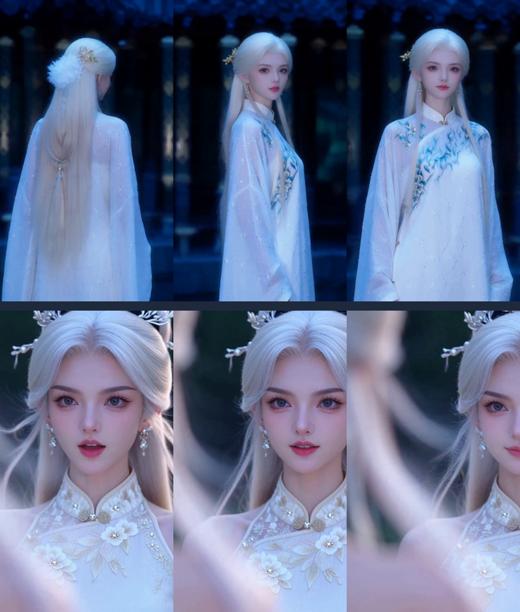

# MV 无限画布 · 使用说明

> 本地 ComfyUI MiniMax H3 驱动，把「人物参考图 + MP3（+ 可选歌词）」自动做成一支 MV。
> 全程在本机运行，不调用任何云端 API。本文面向**实际操作**，照着做即可出片。

---

## 目录

1. [它能做什么](#1-它能做什么)
2. [本机环境与启动](#2-本机环境与启动)
3. [界面总览：8 个节点](#3-界面总览8-个节点)
4. [快速上手：3 步出片](#4-快速上手3-步出片)
5. [逐步操作详解](#5-逐步操作详解)
6. [五条关键规则](#6-五条关键规则)
7. [参数速查](#7-参数速查)
8. [输出文件在哪](#8-输出文件在哪)
9. [常见问题排查](#9-常见问题排查)
10. [不想用画布？命令行方式](#10-不想用画布命令行方式)
11. [耗时与性能建议](#11-耗时与性能建议)

---

## 1. 它能做什么

给它三类输入，它输出一支完整 MV（MP4）：

| 输入 | 是否必填 | 说明 |
|---|---|---|
| 人物参考图 | ✅ 必填 | 1 张清晰正脸/半身照，脸部占比大、光线均匀、无遮挡。png/jpg/webp |
| 歌曲 MP3 | ✅ 必填 | 你的原曲，mp3/wav 均可。**成片时长自动等于这首歌曲的完整时长** |
| 歌词 LRC/TXT | ⭕ 选填 | 不填也能出片；即使填了，也能用 ③ 的「使用歌词」开关一键关闭（关闭后歌词完全不参与） |
| 主题场景 | ⭕ 选填 | 多行输入框，**每行一个场景**（如「舞台，聚光灯，歌手」/「雨夜天桥，霓虹」/「海边日落，温暖」）。自动译成英文，并从**环境、人物、镜头**三个维度写入提示词；多个场景时，一组连续镜头共用一个场景 |

它替你完成的链路：

```
上传素材 → 分析节拍 + 场景/歌词 → 自动分镜（可手动改）
        → 逐镜生成「首帧图」→ 以首帧为起点生成视频（图生视频）
        → 拼接所有镜头 → 铺上你的原曲 → （有歌词才）烧字幕 → 导出 MP4
```

核心特点：
- **人物跨镜头一致**：所有镜头都锁同一张参考图的脸、发型、服装。
- **首帧即视频第一帧**：先出静态帧，再让画面动起来，避免每段视频风格漂移。
- **横屏 / 竖屏自由选**：16:9 或 9:16，两处节点联动，成片自动贯通。

---

## 2. 本机环境与启动

### 前置条件

| 依赖 | 状态检查 |
|---|---|
| ComfyUI 已启动（`127.0.0.1:8188`） | 页面右上角 `C` 绿灯 = 连通 |
| ffmpeg 在 PATH 中 | 页面右上角 `F` 绿灯 = 可用 |
| Node.js 22 + 项目 `node_modules` | 已随项目安装，无需再装 |
| Python 3.13 | 用于生成桥，已就绪 |

### 启动服务

```bash
cd minimaxh3-mv/MVCanvas

# 改过前端代码后才需要重新构建
npm run build

# 启动本地服务
npm start
```

浏览器打开：**http://127.0.0.1:8787**

> 服务只监听 `127.0.0.1`，为本机专用，不对外网开放。
> 若页面右上角两个灯都是绿的，说明环境完全就绪，可以开始做片。

---

## 3. 界面总览：9 个节点

画布从左到右是一条流水线，连线规则固定为 `素材 → 分析 → 分镜 → 首帧图 → 生成 → 导出`：

```
① 人物参考图 ┐
② 歌曲 MP3   ├→ ④ 节拍与场景分析 → ⑤ 分镜台 → ⑥ 分镜首帧图 → ⑦ H3 镜头生成 → ⑧ 合成与导出
③ 歌词(选填) ┘
```

| 节点 | 作用 | 你需要做的事 |
|---|---|---|
| ① 人物参考图 | 上传人物照片，完整预览 + 大小可调 | 点击上传 / 更换，拖动「大小」滑块 |
| ② 歌曲 MP3 | 上传原曲，节点内可直接播放 | 点击上传，点播放器试听 |
| ③ 歌词 | 上传或粘贴歌词（选填）+「使用歌词」开关 | 可跳过；关闭开关则完全不用歌词 |
| ④ 节拍与场景分析 | 分析歌曲、切分镜、填场景 | 填主题场景，点「分析」 |
| ⑤ 分镜台 | 查看/修改每镜提示词、帧数，镜内单机位、分镜间换机位 | 可选：微调提示词、增删镜头、重排镜头变化 |
| ⑥ 分镜首帧图 | 生成每镜的静态首帧，缩略图完整显示 | 选横竖，可自定义 H3 Image 出图宽高，点「生成 N 张首帧图」；用「预览大小」滑块放大查看 |
| ⑦ H3 镜头生成 | 把首帧变成视频 | 点「生成全部镜头」 |
| ⑧ 合成与导出 | 拼接 + 铺原曲 + 字幕 | 点合成，播放/下载成片 |
| ⑨ 其他工作流 | 把 ComfyUI 里的工作流做成下拉选项，独立运行 | 选工作流 → 勾绑定 → 点运行 |
| ⑩ 拼接成片 | 把几段镜头按顺序拼成一条，铺原曲 + 片名 + 淡入淡出 | 连线收片或手动挑片段，点「拼接」 |
| ⑪ bot 导演台 | 按 MP3 真实时长自动拆分镜，逐镜跑 bot 工作流，最后合成一条长视频 | 「🧩 按 MP3 拆分镜」→「▶ 逐镜生成」→ 自动合成；中断后按钮变「⏵ 继续生成」只补没跑完的镜 |

画布操作：鼠标拖拽移动画布、滚轮缩放、框选节点；右下角 MiniMap 快速定位；顶部「适应画布」一键把所有节点纳入视野。

删除节点：节点标题栏右上角的 `✕` 可直接删掉该节点，挂在它身上的连线会一起消失（不会留下悬空连线）。也可以单击/框选节点（或点选连线）后按 `Delete` / `Backspace`，或用顶部「✕ 删除选中」。误删了别慌：提示条上的「撤销」或 `Ctrl+Z` 能把节点（含原来的位置）和连线一起恢复。在输入框、下拉框里打字/退格不会触发删除。删掉的节点可以用顶部「＋ 添加节点」重新加回来，但原有连线需要手动重连。

### ⑨ 其他工作流怎么用

这个节点是**独立**的，不进 MV 流水线，用来跑 ComfyUI 里现成的其他工作流（数字人口播、动作迁移、海报等）。

1. 打开下拉框，里面是自动扫描出来的工作流（默认扫 `ComfyUI/user/default/workflows` 和 `ComfyUI/user/workflows`，共 30+ 个）。新放进去的 json 点一下 `↻` 就能看到。
2. 选中后会显示：节点数、更新时间、缺哪个插件；下面的「参考图 / 音频 / 提示词 / 种子 / 宽高」只显示**该工作流真正有的**槽位（靠 `LoadImage`、`LoadAudio`、文本节点、seed、width/height 自动识别），不想覆盖就取消勾选。
3. 点「运行」，节点内显示进度、日志、输出；完成后直接播放/下载，文件同时存到 `workspace/outputs/`。
4. 特殊参数（比如 AudioCrop 的起止时间、分辨率档位）用「⚙ 节点参数」面板改：展开节点 → 按节点折叠列出所有可改参数，枚举是下拉、数字带范围、开关是勾选、文本是输入框（长文本自动变多行）。连线驱动的输入、以及已被上方「参考图/音频/提示词/种子/宽高」接管的参数会自动隐藏，不会互相打架。
   - 搜索框可按节点名/参数名过滤；改过的参数标蓝并显示在节点标题右侧的计数徽标上，点 `↺` 单独还原，右上「重置」清空整条工作流的改动。
   - 改动按工作流分别记住（浏览器本地），刷新不丢；运行时自动作为 `patch`（`{ "节点id": { "输入名": 值 } }`）提交，等价于在 ComfyUI 里手动改那个节点。
   - 面板数据来自 ComfyUI 的 `/object_info`，所以 **ComfyUI 在线时**才能读到（离线时面板提示读取失败，其余功能照常）。

### 📽 一键载入默认分镜台流程

顶部工具栏点 **📽 分镜台流程**，会把画布换成默认那条完整链路（旧画布想留就先「保存画布」）：

① 人物参考图 → ④ 节拍与歌词分析 → ⑤ 分镜台 → ⑥ 分镜首帧图 → ⑦ H3 镜头生成 → ⑧ 合成与导出，② 歌曲 MP3、③ 歌词挂在 ④ 上。

1. 素材已经指向工作区现成的图/歌/歌词（`workspace/assets`，歌词取最新的 `lyrics_*.txt`），要换直接点节点里的上传。
2. 参数按常规档位给好：864×480、24fps、20 步、`duration=0`（整首歌）、`maxShots=24`；想快就勾 **Turbo**（自动切 4 步）。
3. 点 ④ 的「分析」生成分镜，然后按 ⑤ 改提示词 → ⑥ 出首帧 → ⑦ 逐镜生成 → ⑧ 合成；也可以直接点右上 **⚡ 一键生成 MV** 整条跑完。
4. 和「🎬 bot MV 画布 / 🧭 bot 导演台」是平级的三套入口：这套走分镜台逐镜编辑，bot 那两套走 `Minimax+H3+bot` 数字人口播。

### 🎬 一键生成 bot MV 画布（4×8 秒数字人）

顶部工具栏点 **🎬 bot MV 画布**，确认后会换成一套用 `Minimax+H3+bot` 搭好的流程（旧画布想留就先「保存画布」）：

1. ① 角色参考图、② 歌曲 MP3 已经指向现成素材（`workspace/mv_bot_1125/character.png` 与《声声慢·戏腔版》），不用再上传。
2. 镜1–镜4 四个工作流节点**各自独立绑定** `Minimax+H3+bot`，参数也各自独立：`AudioCrop` 分别截 1:28–1:36 / 1:36–1:44 / 1:44–1:52 / 1:52–2:00，独立 seed 与输出前缀，提示词已按景别写好。展开任一节点的「⚙ 节点参数」只会看到这一段的设置，改它不影响别的镜头。
3. 逐个点「运行」出片（单镜 8 秒、608×1056，约 4–5 分钟）。跑完的镜头会自动登记，⑩ 拼接节点立刻多出一条片段。
4. ⑩ 拼接成片：默认取所有连进来的镜头（连线顺序＝拼接顺序），填好原曲起点（默认 1:28）、片名、淡入淡出，点「拼接 N 段成片」，几秒后节点里就能播放/下载最终 MP4。没有连线结果时，也可以在下拉框里挑 `workspace/outputs` 里已有的 MP4，按加入顺序拼。
5. 画布会自动记住：节点位置、连线、每个镜头节点的参数都存在浏览器本地（`localStorage`），刷新页面不会被打回初始流程。

### 🧭 bot 导演台（按 MP3 时长自动拆分镜，一条长视频）

顶部工具栏点 **🧭 bot 导演台**，载入的是一张只有一个核心节点的画布（① 角色参考图 → 🎬 bot 导演台 ← ② 歌曲 MP3，右侧可再挂 ⑩ 拼接成片）。

1. 节点进来就读 MP3 真实时长（ffprobe），顶部显示「音频 144.2s / 起点 0:00 / 可用 144s」。
2. 设 **截取起点**（想只做副歌就填 `1:28`）、**截取时长**（留空＝从起点一直做到歌曲结尾；只想做 16 秒就填 `16`）和 **每镜秒数**（默认 8 秒，`AudioCrop` 只吃整秒）；**镜数留空＝按每镜秒数铺满**，手填则把截取时长均分给这么多镜。
3. 点 **🧩 按 MP3 拆分镜**。节点里立刻列出每镜的区间与运镜（景别 × 机位 × 镜头运动三维组合，共 1368 种，见下一节），可点 `✎` 逐镜改提示词或重抽运镜，点 `▶` 单跑某一镜。
4. 点 **▶ 逐镜生成 N 镜**：串行提交（ComfyUI 单队列），单镜进度条实时走，可 ⏹ 停止。整首 144 秒≈18 镜×8 秒，4 步档约 55 分钟 GPU。
5. 全部完成后默认**自动合成**一条长视频（铺原曲对应起点 + 片名 + 淡入淡出）；也可以取消勾选手动点「🎞 合成」。成片在节点底部直接播放/下载。
6. 想换一版剪辑：把导演台连到 ⑩ 拼接成片，它会把已完成的分镜按顺序展开，可另填起点/片名再拼。

#### ⏵ 继续生成：断了只补没跑完的镜

一镜 2–5 分钟，整首动辄一小时起，中途停一下、报个错、关个页面都很常见。导演台的生成按钮会跟着状态变：

| 当前状态 | 按钮 | 行为 |
|---|---|---|
| 还没开跑 | `▶ 逐镜生成 N 镜` | 从第 1 镜开始 |
| 已完成一部分 | `⏵ 继续生成（剩 k 镜 · 从镜 n）` | 只跑 idle / error / paused 的镜，done 的一律跳过 |
| 全部完成 | `全部镜头已生成` | 直接走自动合成，或手动点 🎞 合成 |

几个细节：

- **⏹ 停止 = 暂停，不是失败**：当前那镜会标成橙色的 `⏸ 上次中断`，点继续就从它接着来，不会红一片。
- **能接回原任务**：每镜一提交就把 `runId` 写进节点数据。如果停下/刷新时 ComfyUI 其实还在跑那一镜，点继续会先按 `runId` 查服务端状态——还在跑就接着等，跑完直接收片，**不会重复提交白烧 GPU**。
- **刷新不丢进度**：镜头列表（状态、runId、耗时、视频地址）随画布存在 `localStorage`，刷新后残留的 `running` 会自动转成 `paused`，按钮直接变成继续生成。
- **某一镜反复失败 / 想换参数重跑**：单独点该镜的 `▶`，它会**强制重新提交**（不接续旧任务，用当前步数/清晰度/运镜）。「继续生成」则优先接回原任务，两者分工不同。也可以继续往后跑，最后再回补。服务端重启后残留的 `running` 超过 45 分钟会被判失效，自动重新提交。
- 续跑完成的镜仍然计入自动合成：全部 done 后会照常拼一条长视频。

### 🎥 运镜：风格 × 幅度，一套 1368 种机位组合



> 同一首歌、同一区间、同尺寸（608×1056 / 4 步）的两条实测。上排「中全景 + 背后侧 + 弧线环绕」：0.3s 是背影，4s 转到侧脸回望，7.5s 已接近正面，正是镜头绕人物走弧线的效果。下排「近景 + 过肩 + 缓左移」：人物随镜头左移逐渐偏到画面右侧，前景肩线从无到有。单镜 163s / 166s（含模型冷启动）。

每镜的运镜由三个正交维度拼成，而不是从几条写死的文案里轮流挑：

| 维度 | 档数 | 内容 |
|---|---|---|
| **景别** | 8 | 大特写 / 面部特写 / 近景 / 半身中景 / 中景 / 中全景 / 全景 / 大全景 |
| **机位** | 9 | 正面平视 / 三四侧 / 正侧 / 过肩 / 背后侧 / 低角度仰拍 / 高角度俯拍 / 顶拍 / 贴地低机位 |
| **镜头运动** | 19 | 静止微浮、缓推、缓拉、缓横移、缓左移、缓抬、缓下移、焦点呼吸、极缓变焦、缓摇、弧线环绕、升镜、降镜、跟随、变焦压缩、手持轻晃、快推、半圈环绕、快速横移 |

上面有两个旋钮：

| 旋钮 | 选项 | 作用 |
|---|---|---|
| **运镜风格** | 🎲 混搭 / 🎞 叙事 / 💧 情绪 / 🏛 舞台 | 偏好哪类景别。叙事偏中近景，情绪偏特写与浅景深，舞台偏全景与环绕升降 |
| **动作幅度** | 🪶 稳 / 🎥 中 / 💥 大 | 限制镜头动得多快。稳只有极缓移动，大才出现手持、快推、快速横移 |

分配时守四条规则（长片耐看靠的就是这些）：

- **相邻两镜不撞**：景别、机位、运动三项都与上一镜不同，不会连着两个一样的机位。
- **没有固定周期**：旧版 6 套取模到第 7 镜必然重复；现在 38 镜里同一组合最多复用 2 次，且位置随机。
- **景别与机位配对**：贴地机位只配中景以上，快推只配特写，不会出现「面部特写 + 贴地仰拍」这类怪组合。
- **同种子可复现**：同一基准种子拆出来的运镜每次都一致，只有改种子或点重排才会变。

想调整：

- **🎲 重排运镜**（拆分按钮旁）：保留每镜的区间与种子，只重新分配景别/机位/运动。已生成的片段不会失效，可以只重跑不满意的镜。
- **单镜 🎲**：展开某镜（`✎`）后点「运镜」行右边的骰子，只换这一镜的机位。
- **提示词模板**支持四个占位符：`{motion}` 整套运镜、`{size}` 景别、`{angle}` 机位、`{move}` 运动。想自己控制机位就写成 `{size}，{angle}，{move}` 分开放。

> 幅度「大」属于模型压力测试：手持和快推在 H3 上容易崩脸。建议整片用「中」，只把个别需要爆发的镜单独调到「大」（展开该镜 → `🎲` 换运镜前先改幅度）。

### 速度档：同一套流程快 1.4–2 倍

节点里有一行 **速度档**，点一下同时改「采样步数 + 清晰度」，右边实时显示「≈ 几分/镜」和全片总时长：

| 档位 | 步数 | 清晰度 | 单镜实测 | 适用 |
|---|---|---|---|---|
| ⚡ 极速 | 4 | 0.45MP（480×864） | **124s** | 草稿、远景、赶时间 |
| ⚖ 均衡（默认） | 4 | 0.6MP（608×1056） | **181s** | 成片默认，画质与 8 步同级 |
| 🎬 高质 | 8 | 0.6MP（608×1056） | **257s** | 特写、要极限细节 |

- 这个 LoRA 本来就是 4 步蒸馏版（`minimax_h3_turbo_4step`），跑 8 步属于多算一倍；实测 4 步与 8 步肉眼同级。
- **同一支片子别混用档位**：4 步和 8 步是同 seed 不同轨迹，服装配色会变（金白 ↔ 银蓝）。开工前定档，中途换档就得重跑前面的镜头。
- 单镜还有 70–80 秒固定开销（模型装载 + VAE 解码 + 封装），所以总提速是 1.4×，不是 2×。

⚠️ 每镜秒数改成 8 以外的值时，H3 的 `17n+5` 栅格会有几帧补偿，长视频里逐镜累计可能出现口型轻微漂移——追求稳妥就保持 8 秒。

### ⚡ Veda 开关：高分辨率才划算的那一档

工作流节点的参数面板里（以及导演台的速度档下面）有 **⚡ Veda 稀疏注意力** 勾选框，**默认关闭**。

- 勾上之后，提交时会在 `SageAttentionPatch` → `LoRA` 之后自动插一个 `VedaSparseAttention` 节点，并把下游改接到它；**不改工作流文件**，取消勾选就完全回到原样。
- 同一镜头、同 seed、4 步实测：608×1056 几乎没有变化（141s vs 130–150s）；**768×1280 + 209 帧从 289s 降到 208s（1.39×）**。所以小分辨率不必开，打算提分辨率时再勾。
- 稀疏度固定用 `32`（每 128 token 保留 32 块），预测器自动选 `r2va` 版本，不用手填。
- 前提：ComfyUI 已装 `veda-sparse-attention`，且目录名是合法 Python 模块名（不能带 `-` 或 `@`）。没装或结构不匹配时，任务日志会写一行 `⚠ Veda 未启用：原因`，然后按原配置照常跑完，不会中断出片。

### 🖼 参考图 2：第二张参考图

工作流节点参数面板的「参考图」勾选框下面、导演台的 Veda 勾选框下面，各有一个 **参考图 2** 按钮（`＋ 加一张`）。主图仍来自素材区的参考图，这里额外接一张。

- 它会接到 H3 的 `ref_images.ref_image_1`。工作流里只有一个 `LoadImage` 时，提交时会**临时补一个 LoadImage 节点**接上去，不改工作流文件；不传第二张就完全回到原样。
- **提示词里要用 `<Picture 1>` / `<Picture 2>` 指代**，例如：`严格保持 <Picture 1> 中女子的五官不变，穿着 <Picture 2> 中的服装`。不写标签时模型不知道哪张管脸、哪张管衣服。
- 适合：同一角色的不同角度/全身与半身、服装或配饰参考。**不要放完全无关的图**——实测把主角和白龙马一起喂进去，画面会直接崩坏（毛发质感糊满整帧）。
- 成本：同尺寸 4 步 192 帧，单图 130–150s，双图 **180.7s**，约贵 25%。
- 工作流里如果已经有多个 `LoadImage`，会按槽位顺序一一分配，多出来的槽位保留工作流默认图（不再把同一张图铺满所有槽位）。
- 导演台的参考图 2 是**所有镜头共用**的，逐镜只变截取区间、种子和提示词。


---

## 4. 快速上手：3 步出片

大部分情况只需这三步：

**第 1 步｜填素材**
- 在 ① 上传人物参考图，在 ② 上传歌曲 MP3。
- 歌词可跳过；如果要字幕，在 ③ 上传歌词文件或点「粘贴歌词」输入（输入后 700ms 自动保存），并确保顶部「使用歌词」开关是**开启**状态。如果临时不想用歌词，把开关关掉即可，不用删文件。
- 在 ④ 的「主题场景」框按行填写场景，例如第一行 `舞台，聚光灯，歌手`，第二行 `雨夜天桥，霓虹，孤独`，第三行 `海边日落，温暖`。每行会自动翻译成英文并影响环境、人物、镜头三个维度；多个场景按行把镜头切成连续组，一组镜头固定一个场景。分析完成后节点里可核对翻译与分组覆盖范围。

**第 2 步｜点顶部「⚡ 一键生成 MV」**
- 它会自动跑完：分析 → 首帧图 → 镜头生成 → 合成导出。
- 右侧「任务日志」实时显示进度（每 1.5 秒刷新）。
- 底部「时间轴」按镜头时长比例展示每一镜，并显示缩略画面：生成视频后显示镜头视频（鼠标悬停可播放预览），未生成视频但有首帧图时显示首帧图。右上角可切换「自动 / 首帧图 / 视频」三种显示方式；点击某一镜会选中它并高亮。
- 用 **⑪ bot 导演台** 拆的镜头也会进时间轴：分镜台没有分镜时自动显示导演台的镜头，缩略图随逐镜生成实时补齐（橙色进度条＝生成中、⏸＝上次中断、绿框＝已完成）。点缩略图会把画布定位回导演台；两边都有镜头时，标题旁可切换「分镜台 / 导演台」。

**第 3 步｜取片**
- 完成后在 ⑧「合成与导出」节点内直接播放，或点「下载 MV」。
- 文件也在 `workspace/outputs/` 目录，形如 `<任务ID>_MV.mp4`。

> 想精细控制（改分镜、换镜头风格、单独重跑某阶段），就看下一节的逐步操作。

---

## 5. 逐步操作详解

### ① 人物参考图
点击上传。建议选：正脸、光线均匀、脸部占画面 1/3 以上、不戴口罩/墨镜、背景干净。这张图决定所有镜头里的人物长相。

上传后**默认完整显示整张图**（不裁切）。图下方有「大小」滑块，可把预览调大/调小（96–360px），点「重置」恢复默认；拖动滑块不会拖动节点。

### ② 歌曲 MP3
点击上传。上传后节点内出现**播放器**，可直接点播、暂停、拖进度试听；时长来自分析节点的结果。成片会完整覆盖这首歌，不会只做前 60 秒，且会用这首原曲的音轨替换生成音频。

### ③ 歌词（选填，带总开关）
节点顶部的 **「使用歌词」开关**是歌词总控：

- **开启（默认）**：歌词参与分镜（每镜带台词）并在导出时烧字幕。
- **关闭**：即使已经上传/粘贴了歌词，也**完全不使用**——分镜不含台词、成片不烧字幕。关闭后节点会提示「歌词已关闭」；如果已有分镜是开着歌词生成的，需要**重新点分析**才会清掉旧分镜里残留的歌词。

两种输入方式（仅在开关开启时生效）：
- **上传文件**：`.lrc`（带 `[00:05.20]` 时间戳，配时最准）或 `.txt`（每行一句，脚本按字数 + 鼓点自动估算时间）。
- **粘贴歌词**：点「粘贴歌词」按钮，直接把文本贴进输入框，输入后自动保存。

不选歌词也没关系：出片照常，只是画面不含歌词内容、成片无字幕。

### ④ 节拍与场景分析
- **主题场景（多行）**：每行一个场景，例如 `舞台，聚光灯，歌手` / `雨夜天桥，霓虹，孤独` / `海边日落，温暖`。也支持地点词（`海边`、`带有乐队背景的现代舞台`）和英文（原样使用）。每行会**先翻译成英文**，再从三个维度写进该组镜头的提示词（首帧图也会带上）：
  - 环境：`Setting and environment: seaside sunset.`
  - 人物：`Characters and performer styling: singer.`（没写人物时用 `match the setting above`，让人物造型跟随场景）
  - 镜头/氛围：`Camera style and mood: neon, lonely.`（没写时写 `follow the setting above`，让运镜与色调跟随场景）
- **多场景分组**：有 N 行场景时，镜头按时间顺序切成至多 N 个**连续组**（如 8 镜 3 场景 → 镜头 1–3 / 4–6 / 7–8），同组镜头共用一行场景，不会来回跳场。分析结果会显示每组的中文、英文和覆盖镜头范围；⑤ 分镜台每镜卡片上也会显示所属场景。改完场景需**重新点分析**才会刷新分镜提示词；手动改过的提示词不会被覆盖。
- 点「分析节拍 / 自动配时」。
- 节点会显示：歌曲时长、镜头数、节拍点数量、各段落（intro/verse/chorus…）分布。
- 分析后，时长参数会自动更新为歌曲完整时长。

### ⑤ 分镜台（可编辑）
- 每镜是一张卡片：段落标签、时间范围、场景、镜头变化、歌词、**首帧图提示词**与**视频提示词**两个文本框、帧数输入。
- **两套提示词分开写**：`🖼 首帧图提示词` 只给 H3 Image 用，写静态画面——机位/景别前置（`framing: … so the eyes fill most of the frame; light: …`）、人物造型、场景、定格动作，末尾是 `Still frame, no motion blur, sharp focus`；`🎞 视频提示词` 只给 H3 视频用，写机位 + 运镜 + 音景 + 镜内不切镜头。首帧提示词里**不会出现 `dolly-in / push-in` 这类运动词**，避免静帧被写成运动模糊。
- **镜内不切镜头**：视频提示词里写死 `one continuous take with a single camera setup: no cuts, no camera-angle changes and no inserts inside this shot`，不会在镜内跳切或插空镜。
- **分镜之间换机位**：每镜会自动分配不同的**机位与景别 / 光线 / 运镜 / 表演动作**（如「眼神特写·正面机位 · 柔和轮廓光 · 缓推 · 闭眼演唱」→「环境远景·大远景机位 · 逆光暖晕 · 卡点快推 · 抬手向光」），场景与人物身份保持不变。变化按全片镜头序号连续轮换，跨场景组也不会重复。
- 卡片上的「变化：…」标签显示中文短标签，鼠标悬停可看英文变化句；首帧与视频各用其中对应的一部分（视频多一个运镜维度）。
- **重排镜头变化**：点「🎲 重排镜头变化」，在各自的场景组内把每镜变化整体轮转一位（场景不动），两套提示词里的变化句分别同步替换；手动改过提示词、标记丢失的镜头会把变化句追加到末尾。
- **改提示词**：两个文本框各自独立生效——只改首帧图提示词不影响视频，反之亦然。例如在视频提示词里把 `close-up` 改成 `wide shot`，或在首帧图提示词里加一句 `warm sunset light`。
- **改帧数**：帧数会自动吸附到 H3 要求的 `17n+5` 栅格（如 124、141 帧）。
- **增删镜头**：点「＋ 手动加一镜」或卡片右上角的 ×。
- ⑦ 的「种子 seed」会参与变化轮换：换种子再重新分析，可得到另一套镜头变化组合。
- 底部时间轴同步高亮当前选中的镜头，并在缩略区显示该镜的首帧图或视频。

### ⑥ 分镜首帧图
- **先选方向**：`▭ 横屏 16:9` 或 `▯ 竖屏 9:16`（⑥ 是紧凑选择器，只给两个方向按钮）；更细的分辨率下拉和自由宽高输入在 ⑦ 节点，两处联动。
- 点「生成 N 张首帧图」。用 H3 Image 按「参考人物 + 该镜的**首帧图提示词**（静态）」生成静态帧，与视频提示词互不影响。
- **中途断了不用从头再画**：跑过一轮之后，按钮下方会多出「⏵ 继续生成首帧图（跳过已完成的）」。它回到上次的首帧任务目录，跳过 `keyframes/keyframe_XX.png` 里已有的图，只补中断/失败的那几张；补完后照常写 `keyframes_meta.json`，⑦ 仍能按 i2v 用。
- 生成后在节点内以缩略图网格预览，图片**完整显示不裁切**；鼠标悬停可看该镜歌词。
- 网格上方有「**预览大小**」滑块（64–220px，默认 96px），拖动可放大/缩小每张首帧的显示尺寸，网格会自动重排；点「重置」恢复默认。这只改变画布上的预览，不影响生成图像的分辨率。
- **H3 Image 出图宽高可配置**：默认「跟随视频尺寸」（出图 = 视频分辨率）。勾选「自定义 H3 Image 出图宽高」后，出现「出图宽高」两个数字框（256–2048，失焦或回车生效，输入值自动对齐到 32 的倍数），可自由填任意宽高；另有「×2」按钮按视频尺寸两倍超采样出图、「同视频」按钮一键恢复。
  - 自定义尺寸只影响 H3 Image 生成图片本身（和参考图缩放），**保存时会自动缩放回视频尺寸**（比例不同时中心裁切），所以生成出来的首帧图仍是 `视频宽×视频高`，能正常作为 ⑦ 的 i2v 第一帧。
  - 用途：用更大的画布出图可得到更清晰的细节；但尺寸越大越慢、越占显存，16GB 显存建议不超过视频尺寸的 2 倍。
  - 建议与视频保持相同宽高比（如横屏 864×480 → 1728×960），否则会中心裁切。改动后需**重新生成首帧图**才生效。
- 每帧都是下一阶段视频的**真实第一帧**。

### ⑦ H3 镜头生成
- 设置「种子」（默认 42）。「步长」默认 20；勾选「4步Turbo」会自动锁定为 4 且不可手动改，取消勾选恢复 20。
- 方向选择器与 ⑥ 联动，改一处另一处同步。
- 点「生成全部镜头」。
- **断点续跑**：跑过一轮后按钮下方会出现「⏵ 继续生成（跳过已完成的镜头）」，它沿用上次的 jobId，`server/pipeline_bridge.py` 里 `cmd_generate` 会跳过 `shots/shot_XX.mp4` 已存在且大于 4KB 的镜头，只补缺失的，最后照样写完整的 `generate_meta.json`，可直接接 ⑧ 合成。适合「跑到第 9 镜显存爆了」或「手动停了去改参数」的情况。
- 节点中部会提示当前模式：
  - `✓ 首帧图就绪 → 视频以首帧为起点（i2v）`：正常路径，画面与首帧一致。
  - `○ 尚无完整首帧图 → 参考图直生（r2v）`：没跑首帧图时的退路。
  - `⚠ 首帧图尺寸与当前不一致`：需要回 ⑥ 重新生成首帧。

### ⑧ 合成与导出
- 点「拼接 + 铺原曲 + 字幕」（歌词开关关闭时按钮显示「拼接 + 铺原曲（无字幕）」）。
- 完成后节点内出现播放器，可直接播放或点「下载 MV」。
- 歌词关闭或无歌词时只会铺原曲，不烧字幕。

---

## 6. 五条关键规则

### 规则一：歌词可选，且有总开关
没有歌词也能出片，此时画面按「节拍 + 主题场景」生成，成片无字幕。有歌词时按 LRC 时间戳或字数配时，并烧成字幕。
即使歌词已上传，也能在 ③ 关掉「使用歌词」开关：**关闭后歌词不参与分镜、不烧字幕**，后端会忽略一切歌词来源（包括任务里残留的歌词数据）。关闭后请重新分析以刷新分镜。

### 规则二：时长 = 歌曲时长
成片时长**始终等于整首歌曲时长**，你不需要也不能手动截断。后端用 ffprobe 实测歌曲时长，分镜帧数补足到不短于歌曲，合成时用 `-t 歌曲时长 + -shortest` 精确截断。前端的「时长(s)」框为只读显示。

### 规则三：主题场景多行输入，一组镜头一个场景
在 ④ 填的中文场景会**先翻译成英文**再写进提示词；每行是一个独立场景，可同时写环境（舞台/海边）、人物（歌手/观众/乐队）和镜头氛围（霓虹/复古/孤独/聚光灯），分别写入 `Setting and environment:` / `Characters and performer styling:` / `Camera style and mood:` 三项，没写到的维度用「跟随场景」的英文描述补齐。多个场景时按行把镜头切成**连续组**，同组共用一行场景。它同时影响首帧图和视频。分析节点会显示翻译结果与每组覆盖的镜头范围供核对；想改场景，改完要**重新点分析**才会刷新分镜提示词；已经改过的分镜提示词不会被覆盖（在 ⑤ 手动改过的以手动为准）。

### 规则四：横竖与首帧图尺寸必须一致
- 方向选择器在 ⑥ 首帧图和 ⑦ 镜头生成两处都有，改一处两处同步。
- 横屏：864×480 / 736×416 / 608×352；竖屏 9:16：480×864 / 544×960 / 608×1080。⑦ 节点还多出「视频宽高」两个数字框，可直接填任意宽高（256–2048），不受预设限制；改完失焦或点「应用」生效。
- **切换方向或分辨率后，已生成的首帧图会自动作废**（提示「旧首帧图已作废，请重新生成」），需要回 ⑥ 重新生成。
- 后端也会二次校验：首帧尺寸与当前参数不符时退回 r2v，不会出现「竖屏视频用横屏首帧」的错配。
- ⑥ 的「自定义 H3 Image 出图宽高」是**另一回事**：它只决定 H3 Image 以多大画布出图，保存时会自动缩放回视频尺寸，因此不会破坏上面这条尺寸一致规则；`keyframes_meta.json` 里 `width/height` 仍是视频尺寸，另用 `sourceWidth/sourceHeight` 记录实际出图尺寸。

### 规则五：一个分镜 = 一个连续镜头，变化只发生在分镜之间
每个分镜就是一个机位拍到底的连续镜头：**镜内不切镜头、不换机位、不插空镜**。提示词里固定写 `one continuous take with a single camera setup: no cuts, no camera-angle changes and no inserts inside this shot`，避免 H3 在同一镜里自行切镜；镜内的运镜只能是同一个机位上的连续运动（缓推、横移、环绕、升降、固定机位等）。

想要更多变化，就让**不同分镜用不同的机位**：每镜自动轮换机位与景别（正面、左前 3/4、右侧、背后过肩、低角度仰拍、高位俯拍、侧面、远机位…）、光线、运镜与表演动作，副歌偏全景、主歌偏近景。所有变化只改机位与表演，**不换场景、不换人物身份**；提示词里以 `Variation for this shot in the same scene: …` 明确"与相邻分镜用不同机位"。分镜台可查看变化标签或点「重排镜头变化」重新分配。

---

## 7. 参数速查

| 参数 | 所在节点 | 默认值 | 说明 |
|---|---|---|---|
| 使用歌词 | ③ 歌词 | 开 | 总开关；关闭后歌词不参与分镜、不烧字幕 |
| 主题场景 | ④ 分析 | 空 | 多行，每行一个场景；自动译成英文并从环境/人物/镜头三个维度写入提示词；多场景时一组连续镜头共用一个场景 |
| 时长(s) | ⑦ 生成 | 自动 | 只读，= 歌曲完整时长 |
| 步长 steps | ⑦ 生成 | 20 | 采样步数，越大越精细越慢；勾选 Turbo 自动锁定 4、取消恢复 20 |
| 种子 seed | ⑦ 生成 | 42 | 固定种子可复现结果；换种子可重抽画面 |
| 镜头上限 | ④ 分析相关 | 24 | 整首歌最多切多少镜 |
| 4步Turbo | ⑦ 生成 | 关 | 勾选即自动锁定 4 步并加载 Turbo LoRA（快约 5 倍、细节略降）；取消恢复 20 步 |
| 烧歌词 | ⑦ 生成 | 开 | 歌词开关关闭或无歌词时自动不生效（复选框变灰） |
| 方向/分辨率 | ⑥ 和 ⑦ | 横 864×480 | 两处联动，切换作废旧首帧图；这是**生成图像**尺寸 |
| 视频自定义宽高 | ⑦ 镜头生成 | 跟随所选分辨率 | 直接填 256–2048 的任意宽高，自动对齐 32 的倍数，不受预设限制 |
| H3 Image 出图宽高 | ⑥ 分镜首帧图 | 关（跟随视频） | 勾选「自定义」后可填出图宽高（自动对齐 32 的倍数），保存时自动缩放回视频尺寸；建议同比例、不超过 2 倍 |
| 参考图预览大小 | ① 参考图 | 180px | 仅改变画布上显示大小，默认完整显示全图 |
| 首帧图预览大小 | ⑥ 分镜首帧图 | 96px | 仅改变缩略图显示大小（64–220px），网格自动重排 |

---

## 8. 输出文件在哪

所有产物在工作目录下：

```
MVCanvas/
├── workspace/
│   ├── assets/              上传的素材、粘贴的歌词
│   ├── jobs/<任务ID>/       每个任务的中间产物
│   │   ├── 分镜表.md        本任务的分镜与每镜提示词
│   │   ├── keyframes/       各镜首帧图
│   │   ├── shots/           各镜生成的视频片段
│   │   ├── keyframes_meta.json / generate_meta.json
│   │   ├── *_state.json     任务状态与日志（页面轮询的就是它）
│   │   └── MV_final.mp4     该任务的成片
│   └── outputs/<任务ID>_MV.mp4   ← 最终成片（页面下载的就是它）
└── dist/                    前端构建产物（服务直接托管）
```

---

## 9. 常见问题排查

**Q：提示「请先连接歌曲和歌词」，但我明明选好了**
A：现在歌词已改为选填，只强制校验「人物参考图 + 歌曲」。如果仍提示缺素材，通常是：① 刷新页面后素材文件被清理——重新上传即可；② 歌词粘贴后未落盘——现在输入后 700ms 自动保存，稍等片刻再看状态徽标。

**Q：右上角 `C` 灯是红的**
A：ComfyUI 没连上。先启动 ComfyUI Desktop，确认它在 `127.0.0.1:8188` 运行，再刷新页面。

**Q：右上角 `F` 灯是红的**
A：ffmpeg 不在 PATH。确认 ffmpeg 已安装并加入系统 PATH，重启服务后再刷新。

**Q：切到竖屏后提示首帧图作废**
A：正常保护机制。首帧图是视频第一帧，尺寸必须和视频一致。回 ⑥ 重新生成首帧图即可。

**Q：自定义了 H3 Image 出图尺寸，会不会和视频尺寸对不上**
A：不会。自定义尺寸只用于 H3 Image 出图，保存前会自动缩放回视频尺寸，`keyframes_meta.json` 里记录的仍是视频尺寸，⑦ 照常走 i2v。若自定义尺寸与视频宽高比不同，会做中心裁切，所以建议保持同比例（如 864×480 → 1728×960）。改动后记得重新生成首帧图。

**Q：生成的视频没有歌词字幕**
A：依次检查 ③ 的「使用歌词」开关是否开启、是否上传/粘贴了歌词、⑦ 的「烧歌词」是否被关掉。三者都满足才会烧字幕；开关关闭时后端也会强制不烧。

**Q：点合成后提示失败 / 播放器打不开，但文件其实已生成**
A：成片已在 `workspace/outputs/` 且接口返回"合成完成"时，属播放器路径问题。现已修复：接口会把相对路径自动转成 `/media/outputs/...`，播放器与下载链接均可正常打开。若仍失败，看 ⑧ 节点内的红色提示与任务日志；也可直接到 `workspace/outputs/` 手动取片。

**Q：成片时长不对，比歌曲短/长**
A：正常误差来自 H3 帧数栅格（`17n+5`），末镜会补到不短于歌曲，合成阶段再按歌曲时长精确截断，成片与歌曲等长。

**Q：生成很慢 / 卡住**
A：整首歌约 20–30 镜，16GB 显存下 2–3 小时属正常。先看右侧日志确认进度在推进。想先验证效果，建议用一首短歌或先跑首帧图阶段。

**Q：服务重启后任务还在吗**
A：生成子进程会继续跑完，但页面的日志轮询会断开。任务状态文件仍在 `workspace/jobs/<任务ID>/`，可重新加载画布或刷新页面查看。

---

## 10. 不想用画布？命令行方式

项目根目录还有一份纯脚本管线 `MV制作交付/auto_mv.py`，只用 Python 标准库，适合批处理或自动化：

```bash
cd "minimaxh3-mv/MV制作交付"

python auto_mv.py --image "D:\素材\singer.png" --audio "D:\素材\song.mp3" --scene "海边" --burn-subs
```

- `--lyrics` 可选，不传就是无歌词无字幕。
- `--no-lyrics` 歌词总开关：即使传了 `--lyrics` 也完全不用（等价于画布里关掉「使用歌词」）。
- `--scene` 主题场景，支持多行（命令行里用引号包裹并用 `\n` 换行，或用 shell 的 `$'第一行\n第二行'`），每行一个场景，自动翻译成英文并从环境/人物/镜头三个维度写入提示词；多场景时一组连续镜头共用一个场景。分镜表会显示每行中文原文、英文结果及各镜所属场景。
- `--dry-run` 只分析并写出分镜表和工作流 JSON，不实际渲染——**强烈建议首次使用先跑一次**。
- 成片输出到 `MV制作交付/输出/`。

---

## 11. 耗时与性能建议

- 本机：RTX 5080 Laptop 16GB 显存、约 64GB 内存、模型库 `D:\ai\models`（约 506GB）。
- 整首歌（约 5 分钟）拆 20–30 镜，16GB 显存下 **2–3 小时**。
- 首次使用建议：
  1. 先用 `--dry-run` 或只跑「分析 + 首帧图」看分镜和人物效果；
  2. 确认方向、场景、人物都满意后，再跑完整生成；
  3. 用一首短歌走通全流程，再上正式曲目。

---

*文档版本：对应 2026-11-26 功能状态（歌词可选+开关 / 时长=歌曲 / 主题场景多行输入+三维度提示词+镜头分组 / 单镜单机位·镜内不切镜头·分镜间换机位 / 首帧图与视频提示词分开写 / 场景自动译成英文 / 首帧图横竖选择+预览大小可调 / H3 Image 出图宽高可配置+视频宽高自由输入 / 参考图大小可调 / MP3 可播放 / Turbo 勾选自动 4 步 / 时间轴显示首帧图或视频 / ⑨ 其他工作流：扫描 ComfyUI workflows 目录生成下拉选项并自动绑定图音 / 每节点参数可视化面板（枚举下拉·数字·勾选·文本，改动即 patch，按工作流本地记忆） / 节点删除：标题栏 ✕、Delete/Backspace、工具栏删除选中，级联删连线，支持提示条撤销与 Ctrl+Z / ⑩ 拼接成片：连线自动收片或手动挑片段，统一规格后 concat + 铺曲 + 片名/淡入淡出 / 🎬 bot MV 画布预设：4 个独立绑定的分段镜头 + 拼接收口 / 工作流节点可各自绑定工作流与参数 / 画布节点、连线本地持久化 / ⑪ bot 导演台：按 MP3 真实时长自动拆分镜（逐镜独立区间与种子），串行跑 Minimax+H3+bot 后自动合成一条长视频，已完成分镜可展开给 ⑩ 拼接 / 🎥 运镜系统：景别8×机位9×运动19=1368 种组合，风格（混搭/叙事/情绪/舞台）×幅度（稳/中/大）双旋钮，相邻不撞机位、无固定周期、景别机位配对，支持全局重排与单镜重抽 / 整首 144 秒≈18 镜≈1.3 小时 GPU / 速度档：4 步均衡 181s·极速 124s·8 步 257s，实测工作流默认改 4 步 / ⚡ Veda 开关：工作流节点参数面板与导演台各一个，默认关，勾选后提交时在 LoRA 之后插 Veda 节点、不改工作流文件，不可用会打日志并降级为原配置）。*
