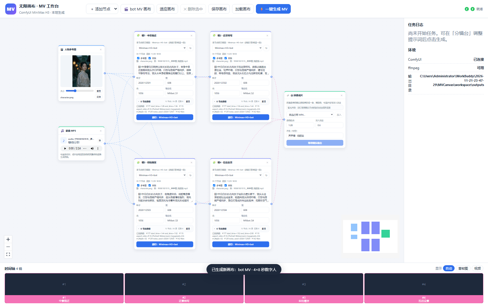
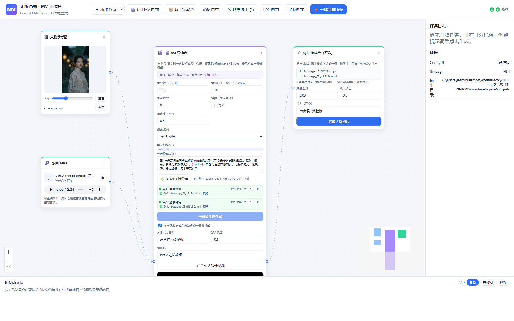

# MiniMax H3 歌曲 MV 工作台

> 一张人物照片 + 一首歌，在**自己的电脑**上用 ComfyUI 生成一支对口型、卡节拍、带字幕的完整 MV。
> 不调用任何云端 API，素材不出本机，按小时算只有电费。

<p align="center">
  
</p>

---

## 这是什么

给它三样东西：

| 输入 | 必填 | 说明 |
|---|---|---|
| 人物参考图 | ✅ | 一张清晰正脸/半身照。脸部占比大、光线均匀、无遮挡效果最好 |
| 歌曲 MP3 | ✅ | mp3 / wav 都行。**成片时长自动等于整首歌**，不用先剪 |
| 歌词 LRC / TXT | ⭕ | 不填也能出片；填了就按时间轴烧字幕 |

它替你做完整条链路：

```
参考图 ┐
MP3   ├→ 节拍分析 → 自动分镜 → 逐镜首帧图 → H3 逐镜生成 → 拼接 → 铺原曲 → 烧字幕 → MP4
歌词   ┘
```

几个关键设计：

- **卡点**：按鼓点 onset 吸附镜头切点，切镜落在拍子上。
- **锁人物**：每一镜都带同一张参考图；有首帧图时走图生视频，第一帧就是成片真实第一帧，脸不会跑。
- **镜内不切**：每个分镜固定 `one continuous take`，靠换机位/景别/光线做变化，避免模型自己乱切镜。
- **长曲自动拆**：导演台节点按 MP3 时长切成 N 个 8 秒分镜，逐镜跑完自动拼成一条长视频。
- **可加第二张参考图**：工作流节点与导演台都能额外接一张图（服装 / 场景），走 H3 的 `ref_images.ref_image_1`，提示词里用 `<Picture 1>` / `<Picture 2>` 指代。代价是同尺寸约 +25% 耗时，详见 `MVCanvas/README.md`。

## 两种用法

| 方式 | 适合 | 入口 |
|---|---|---|
| **无限画布**（推荐） | 边做边改，看进度、单镜重跑、手动调分镜 | `MVCanvas/` |
| **命令行** | 一次跑完整首、批处理、挂机 | `MV制作交付/auto_mv.py` |

---

## 一、准备工作

> 先说清楚：**这不是开箱即用的一键软件**。它是一套跑在本机 ComfyUI 上的工作台，前置条件是已经能正常跑 MiniMax H3 的 ComfyUI 环境（模型数十 GB、若干自定义节点）。如果你还没搭过 H3，建议先在 ComfyUI 里跑通官方示例，再回来用这个仓库。

### 1. 环境

| 项 | 要求 |
|---|---|
| 系统 | Windows / Linux 均可（开发环境为 Windows） |
| 显卡 | NVIDIA，**建议 16GB 显存起**（实测 RTX 5080 Laptop 16GB） |
| ComfyUI | ≥ 0.38，跑在 `http://127.0.0.1:8188`（实测 0.46.2） |
| Node.js | 20.19+ 或 22.12+（Vite 7 的要求） |
| Python | 3.10+（命令行方式用，纯标准库，无需 pip 装包） |
| ffmpeg | `ffmpeg` 与 `ffprobe` 都在 PATH 里 |

### 2. 模型

放到 ComfyUI 对应的模型目录（`ComfyUI/models/...`）。文件名要和下面一致，否则工作流加载不到：

| 目录 | 文件 |
|---|---|
| `diffusion_models/` | `minimax_h3_ref2va_pruned_int8_convrot.safetensors` |
| `text_encoders/` | `qwen3vl_32b_minimax_h3_nvfp4_awq.safetensors` |
| `vae/` | `minimax_h3_video_vae_fp16.safetensors`、`minimax_h3_audio_vae_fp32.safetensors` |
| `loras/` | `minimax_h3_turbo_4step_diffusion_model.safetensors`（4 步蒸馏 LoRA，提速关键） |

### 3. ComfyUI 自定义节点

| 节点包 | 提供的节点 | 是否必须 |
|---|---|---|
| `comfyui-kjnodes` | `MiniMaxH3MemoryEfficientSageAttentionPatch`，**最主要的加速手段** | 必须 |
| `comfyui-videohelpersuite` | `VHS_VideoCombine`（存视频） | 必须 |
| `ComfyUI_MiniMaxH3_Director` | `MiniMaxH3Director`（6 镜模板用的导演节点） | 必须 |
| `soundflow` | `SoundFlow_GetLength`（读歌曲时长） | 必须（导演台流程） |
| `comfyui-vrgamedevgirl` | `VRGDG_MiniMaxH3AudioDrive`（音频驱动） | 必须（bot 工作流） |
| `rgthree-comfy` | `Label` 等标注节点 | 可选（不影响出片） |
| `ComfyUI-MiniMax-H3-Turbo` | Turbo 采样节点（新版 ComfyUI 下等价于原版 euler，无额外提速） | 可选 |
| `veda-sparse-attention` | 稀疏注意力，高分辨率才划算，见[性能](#六性能参考) | 可选 |

核心节点（`MiniMaxH3ReferenceToVideo`、`ResolutionSelector`、`ComfyMathExpression`、`CreateVideo` / `SaveVideo` 等）随 ComfyUI 本体提供，不用单独装。

> ⚠️ **Windows 上目录名不能带 `-` 或 `@`**。ComfyUI 会按目录名做动态 import，`veda-sparse-attention@0_3_1` 这种名字会直接导入失败。装完把目录改成 `veda_sparse_attention` 这类合法模块名。
> 另外：**不要在 ComfyUI-Manager 里禁用** `comfyui-vrgamedevgirl`，禁了会把目录丢进 `.disabled`，工作流立刻报“节点不存在”。

### 4. 把工作流放进 ComfyUI

画布是通过 ComfyUI 的 `user` 目录扫描工作流的。把 `MV制作交付/MV_6镜头_H3参考生视频_工作流.json` 复制到：

```
ComfyUI/user/default/workflows/
```

或者直接复制你自己在 ComfyUI 里调好的 H3 工作流——画布会自动识别它有哪些可填槽位。

---

## 二、五分钟跑通（画布）

```bash
git clone https://github.com/dreign/minimaxh3-mv.git
cd minimaxh3-mv/MVCanvas

npm install
npm run build
npm start
```

浏览器打开 **http://127.0.0.1:8787**。

右上角有两个小圆点，先确认它们是绿的：

- **C** = ComfyUI 连通（`127.0.0.1:8188` 有响应）
- **F** = ffmpeg 可用

然后：

1. 点工具栏 **🧭 bot 导演台** —— 载入预设画布：参考图、MP3、导演台、拼接四个节点已经连好。
2. 在**参考图**节点上传照片，在 **MP3** 节点上传歌曲。
3. 导演台上填「起点」（从第几秒开始做，默认 0）和「每镜秒数」（默认 8），镜数会自动按歌长算出来。
4. 点 **▶ 逐镜生成**。

之后就不用管了：它会一镜一镜排队跑，每个镜头显示进度和耗时，单镜可以单独重跑（▶）。全部跑完自动拼接成一条长视频，点 **下载长视频**。

<p align="center">
  
</p>

> 想看单镜效果可以先只跑第一镜，满意了再继续。整首 5 分钟的歌大约 38 镜，16GB 卡上要跑一个多小时。

### 另一条路线：🎬 bot MV 画布

固定 4 个 8 秒镜头的模板（原曲 1:28–2:00 段落），适合先摸清参数、或者只做副歌。逐镜手动运行，改提示词/换参考帧都更灵活。

---

## 三、命令行跑整首

```bash
cd minimaxh3-mv/MV制作交付

# 先只分析，不渲染，输出分镜表给你看
python auto_mv.py --image 歌手.png --audio 歌曲.mp3 --lyrics 歌曲.lrc --dry-run

# 确认没问题再去掉 --dry-run 正式跑（竖屏示例）
python auto_mv.py --image 歌手.png --audio 歌曲.mp3 --lyrics 歌曲.lrc \
  --width 608 --height 1056 --burn-subs --turbo --steps 4
```

常用参数：

| 参数 | 说明 |
|---|---|
| `--image` / `--audio` | 参考图 / 歌曲（必填） |
| `--lyrics` | LRC 或 TXT；`--no-lyrics` 可强制不用 |
| `--scene` | 主题场景，**每行一个**（如 `舞台，聚光灯`、`雨夜天桥，霓虹`），会译成英文写进提示词 |
| `--shot-seconds` | 每个分镜多少秒，默认 `5.17`（切点仍会吸附鼓点） |
| `--max-shots` | 最多几个分镜，默认 `24` |
| `--width` / `--height` | 输出分辨率，默认 `864×480` 横屏；竖屏建议 `--width 608 --height 1056` |
| `--steps` | 采样步数，默认 `20`；配 `--turbo` 时用 `4` |
| `--burn-subs` | 把歌词烧进画面 |
| `--song-offset` | 从原曲第几秒开始做 |
| `--dry-run` | 只出分镜表，不调 ComfyUI |

`python auto_mv.py --help` 有完整列表。

---

## 四、成片在哪

| 方式 | 位置 |
|---|---|
| 画布 | 节点上直接点「下载」；文件实际在 ComfyUI 的 `output/` 目录下 |
| 命令行 | 默认写到 `MV制作交付/输出/`，可用 `--out-dir` 改 |

拼接用的中间片段也留在 `output/` 下，方便单独拿某一镜去二次剪辑。

---

## 五、路径配置

**不配也能启动**，但默认值是按作者的目录布局推断的（`~/ComfyUI-Shared/...`、`~/ComfyUI-Installs/...`）。**大多数人的 ComfyUI 装法不一样，第一次用请先设这几个变量**，否则会出现“工作流列表为空”或“找不到输出文件”。

| 变量 | 作用 | 默认 |
|---|---|---|
| `COMFY_URL` | ComfyUI 地址 | `http://127.0.0.1:8188` |
| `COMFY_INPUT` | ComfyUI 输入目录 | `~/ComfyUI-Shared/input` |
| `COMFY_OUTPUT` | ComfyUI 输出目录 | `~/ComfyUI-Shared/output` |
| `COMFY_USER_DIR` | ComfyUI 的 `user` 目录（扫工作流用） | `~/ComfyUI-Installs/ComfyUI/ComfyUI/user` |
| `COMFY_WORKFLOW_DIRS` | 直接指定工作流目录，分号分隔（优先级最高） | — |
| `PYTHON_BIN` | 生成层用的 Python 解释器 | `python` |

不知道填什么？在 ComfyUI 里存一次工作流，看它落在哪个目录，那个目录的上一级就是 `COMFY_USER_DIR`。

macOS / Linux：

```bash
export COMFY_USER_DIR="$HOME/ComfyUI/user"
export COMFY_INPUT="$HOME/ComfyUI/input"
export COMFY_OUTPUT="$HOME/ComfyUI/output"
npm start
```

Windows：

```bat
set COMFY_USER_DIR=D:\ComfyUI\user
set COMFY_INPUT=D:\ComfyUI\input
set COMFY_OUTPUT=D:\ComfyUI\output
npm start
```

---

## 六、性能参考

竖屏 MV，4 步蒸馏 LoRA + SageAttention，单镜 8 秒（192 帧），RTX 5080 Laptop 16GB：

| 配置 | 分辨率 / 帧数 | 单镜耗时 | 整首 38 镜 |
|---|---|---|---|
| **4 步 + Sage（推荐）** | 608×1056 / 192 | 130–150s | ≈ 85 分钟 |
| 8 步 + Sage | 608×1056 / 192 | ≈ 257s | ≈ 160 分钟 |
| 4 步 + Veda(16) | 768×1280 / 209 | ≈ 208s | ≈ 130 分钟 |
| 3 步 + Sage | 608×1056 / 192 | ≈ 115s | 草稿档，画质不可交付 |

三条经验（表中「整首 38 镜」按 306 秒的歌、导演台默认每镜 8 秒估算）：

1. **4 步就是最优解**。LoRA 本身是 4 步蒸馏版，跑 8 步纯属白算一倍时间。
2. **Veda 只有上高分辨率才回本**。608 短镜头下 attention 只占三分之一，开不开差不多；768×1280 才有 1.3–1.4×。所以想要画质升级，用 768 + Veda 比“768 硬跑”划算得多。画布的工作流节点参数面板里（以及导演台速度档下面）有 **⚡ Veda** 开关，默认关闭，勾上只影响提交的那一次运行。
3. **3 步只能当草稿**。发丝、纱料、金线刺绣会明显糊化。同一项目里**不要混用步数**，采样轨迹不同，画风会飘。

---

## 七、跑不通时

| 现象 | 原因 / 处理 |
|---|---|
| 右上角 C 是红的 | ComfyUI 没起，或不在 8188。先 `curl http://127.0.0.1:8188/system_stats` 确认 |
| 工作流下拉是空的 | 工作流没放进 `ComfyUI/user/default/workflows/`，或路径不对，设 `COMFY_USER_DIR` |
| 报“节点不存在” | 自定义节点缺包，或插件被 Manager 禁用丢进了 `.disabled`，把目录移回来 |
| 报 `Invalid audio file` | 音频必须传 ComfyUI 能访问的**绝对路径**，不能只给文件名 |
| 生成的画面糊、发灰 | 步数太低（<4），或分辨率被压到 512 附近 |
| 人物脸跑了 | 参考图不够清晰，或没走图生视频。用「取已生成帧当参考」比改提示词有效 |
| 镜头时长对不上 | H3 帧数受 `17n+5` 栅格约束，24fps 下 8 秒正好 192 帧。音频裁剪只吃整秒 |
| 跑得比预期慢一倍 | 检查是不是还在跑 8 步；再确认 SageAttention 节点生效 |

---

## 八、目录结构

```
MVCanvas/                    无限画布（前端 TS + React + Vite，后端 Node 内置 HTTP，无数据库）
  src/                       画布、节点、状态管理
  server/                    静态托管、任务调度、ComfyUI 桥接、ffmpeg 拼接
  presets/                   画布预设 JSON + 界面截图
  README.md                  画布技术说明
  MV无限画布_使用说明.md      逐节点操作手册、接口表、速度档
MV制作交付/
  auto_mv.py                 命令行一键管线（纯标准库）
  歌曲MV制作流程.md            命令行版完整流程
  分镜头需求_示例.md           分镜表模板
  MV_6镜头_..._工作流.json     ComfyUI 工作流模板
build_mv_workflow.py         从 Director 模板生成工作流的辅助脚本
```

---

## 九、限制

- 只针对 MiniMax H3 这条音视频联合生成链路；换模型要改 `server/workflow_lib.cjs` 和工作流 JSON。
- 仓库不含模型权重与示例素材，需自行准备（见[准备工作](#一准备工作)）。
- 单镜生成是串行的，没有多卡/并发调度。想要更快只能上更好的卡或改分辨率。
- 本机渲染，速度完全取决于显卡；16GB 显存是能跑通的下限，不是舒适线。

## License

MIT
